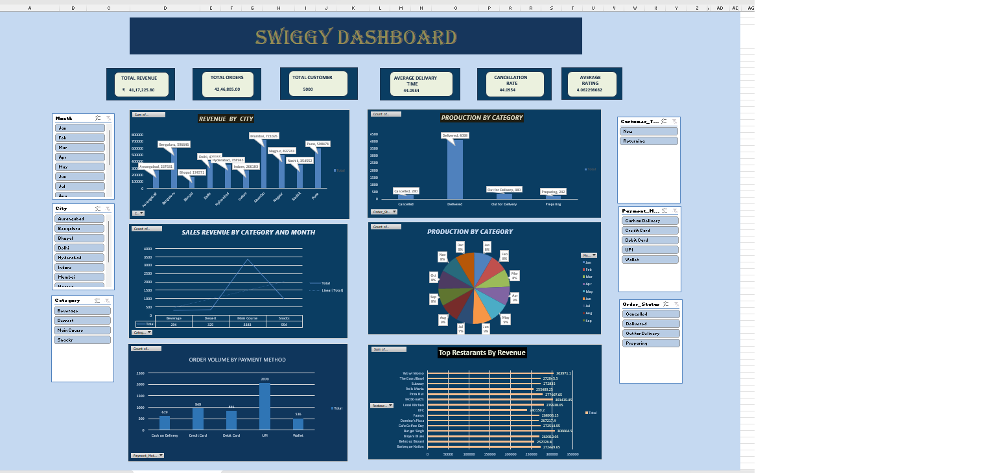

# 📊 Swiggy Sales Analysis Dashboard

## 📌 Project Overview
This project analyzes 5,000 Swiggy order records using Microsoft Excel.

The interactive dashboard provides insights into sales performance, customer orders, restaurant performance, and revenue trends.

## 🛠️ Tools Used
- Microsoft Excel
- Pivot Tables
- Pivot Charts
- Slicers
- Data Visualization
- Data Analysis

## 📈 Key Features
- Total Revenue Analysis
- Total Orders Analysis
- Customer Analysis
- Revenue by City
- Monthly Sales Analysis
- Sales by Category
- Payment Method Analysis
- Order Status Analysis
- Top Restaurants by Revenue
- Interactive Slicers and Filters

## 🎯 Project Objective
To analyze Swiggy sales data and identify useful business insights through an interactive Excel dashboard.

## 🖼️ Dashboard Preview

## 📁 Project Files
- `Swiggy_5000_Rows_Dashboard_Data.xlsx` — Excel workbook containing the project data and dashboard.
- `Swiggy_Dashboard.png` — Dashboard screenshot.

## 👩‍💻 Author
**Akanksha Mohitkar**
